<div align="center">

<!-- HERO BANNER -->


</div>

---

<div align="center">

<!-- TYPING SVG - Animated cycling roles -->
[](https://git.io/typing-svg)

</div>

---

## 🧑‍💻 About Me

<div align="center">

</div>

<br/>

```ts
const asif = {
  name:         "Asif Mahmud",
  username:     "oficialasif",
  role:         ["Full Stack Web Developer", "SQA Engineer", "Flutter App Developer"],
  education:    "BSc in CSE, MSc in SWE (Cyber Security) — DIU",
  location:     "Dhaka, Bangladesh 🇧🇩",
  currentFocus: "Building scalable web & mobile apps with robust quality",
  hobbies:      ["⚽ Football", "🏍️ Bike Tours", "✈️ Travelling"],
  funFact:      "I debug code the same way I ride a bike — keep going until I figure it out!"
};
```

---

## 🛠️ Tech Stack & Skills

<div align="center">

</div>

<br/>

<div align="center">

<!-- Languages -->


<!-- Frameworks & Mobile -->


<!-- Databases & Cloud -->


<!-- Tools -->


</div>

---

## 🚀 Featured Projects

<div align="center">
<table>
<tr>
<td align="center" width="33%">

### 🛍️ The Retro Life
Fashion and lifestyle product selling e-commerce platform with seamless shopping, cart & checkout.

**Stack:** React · Next.js · MongoDB

[](https://theretrolife.vercel.app/)

</td>
<td align="center" width="33%">

### 🛸 Orbit App
Classified marketplace mobile app (like Bikroy.com) built with Flutter for buying, selling & discovering products locally.

**Stack:** Flutter · Dart · Firebase

[](https://github.com/oficialasif/ORBIT)

</td>
<td align="center" width="33%">

### 🎮 DIU Esports Community
Official DIU Esports community platform for tournaments, team events & gaming community.

**Stack:** React · Next.js · Node.js

[](https://diuec.vercel.app/)

</td>
</tr>
</table>
</div>

---

## 📊 GitHub Stats

<div align="center">


</div>

<div align="center">


</div>

---

## 🤝 Let's Connect

<div align="center">

[](https://facebook.com/OficialAsif)
[](https://instagram.com/oficialasif360)
[](https://linkedin.com/in/oficialasif)
[](https://github.com/oficialasif)

</div>

---

<div align="center">


**"Code is poetry — I write it with passion."** — *Asif Mahmud*


</div>
